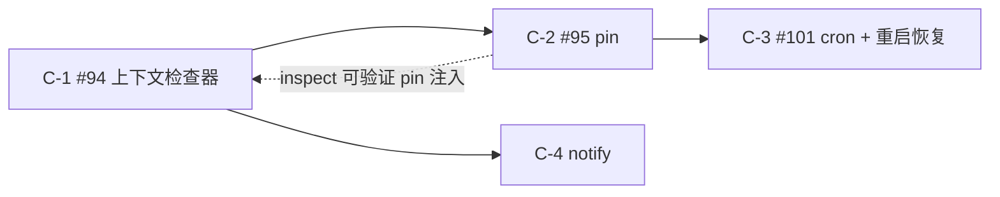

# 上游 Issue 修复计划与方向

对象：[kernel4632/agent](https://github.com/kernel4632/agent) 的 open issues（2026-11-27 快照，30 个）。
方法：逐条对**本仓库**（amnssb/agent fork，`feat/monitor-extension` @ a9ce8fd）静态核实 + HTTP 探针实测。上游 issue 是对着上游代码写的，本仓库已大幅演化，直接照单执行会重做已完成的事。

结论分级：✅ 已实现 ｜ 🔶 部分成立 ｜ ❗ 仍然成立 ｜ ➖ 不适用

## 一、Issue 与本仓库现状对照

| Issue | 主题 | 本仓库核实 | 结论 |
|---|---|---|---|
| #128 | CSRF 同源守卫 | 探针实测：`form-urlencoded` POST（`input=csrf-probe`）**穿过 body 校验到达指令层**（返回 404 Session not found——真实会话下就是执行）；`text/plain` + JSON 被 400 拦住；恶意 Origin 的 JSON POST 同样到达指令层；`GET /health`、SSE GET 无任何 Origin 检查 | ❗ |
| #129 | todo 非原子写 | todo 已改为**历史承载**（`extensions/todo/tool.js` 的 execute 返回结构存进 tool-result，`todo.list` 从历史读）——不再写 todos.json，issue 前提失效。但**同款模式真实存在**：`extensions/monitor/engine.js` 的 `saveSessionMonitors` 用 `Bun.write` 直写 monitors.json，`loadSession` 的 `catch {}` 吞掉坏档（监控静默清空）；`server/features/extension.js` 的 `saveDisabled` 直写 extensions.json，`readDisabled` 的 `.catch(() => ({}))` 吞坏档（**禁用名单静默重置、扩展全部回来**）。仓库已有原子写先例：`features/config.js` 用 `atomically` 包 | 🔶 |
| #122 | 测试 flaky | `tests/setup.js` 已重写（单一根目录 mkdtemp + exit 清理 + `Path.lock` 纪律），比上游描述的干净；但失败用例名从未抓到过，本仓库是否还 flaky 未测 | 🔶 |
| #127 | 构建产物过大 | `dist`：index 1.0M、exports 688K、chunk 648K。mermaid/cytoscape/katex 已独立 chunk，**hugeicons 全量仍进 exports**，highlight.js 在 index 里 | ❗ |
| #123 | Snapshot 分页 | ✅ 方案 1 已做：`?after=<messageId>` 增量读（`getSessionDelta`，前端注释「28 MB → 几 KB」）、`?segmented=true` 首开只读当前段、SSE 断线重连走 delta refresh。只剩「压缩后物理缩短历史」（需 core 定义可丢弃标记） | ✅ |
| #130 | core 升级通道 | 依赖为 `@kernel4632/agent-core 0.37.0`。`receive()` 兜底走 `receiveMessage`，未知事件**静默忽略**（无 dev 告警）；上游提到的 demo.ts/mock.js 不存在于本仓库，等价物是 `frontend/tests/protocol.test.js` 手写 SSE 帧 + `chat-fixture.js` | 🔶 |
| #125 | 类型声明同步 | 本仓库无 .d.ts 手抄层（find 零命中），issue 前提失效。等价面：manifest.json 的 `cli.commands[].op` 声明与 backend.js 实际注册的 op 之间无一致性检查 | ➖ |
| #124 | 生命周期事件 | 后端有 `ctx.onDispose`（monitor 已正确使用）；无 `onStart`；前端 `features/extensions.js` 的 `owned` 只撤销注册项（pages/toolViews/panels/topbar/styles），**扩展自己开的定时器/连接无处撤销** | 🔶 |
| #126 | 依赖降级姿势 | 本仓库 ctx 无 `use()`（只有 patch/op/onDispose/expose），扩展间通信只有 `requires` 硬边 + 级联停用（Loader 已实现）；缺的只是文档 | 🔶 |
| #121 | monitor 扩展 | ✅ 已实现（c22b0f7 起）：四类条件、TTL 淘汰、3 次失败熔断、`pending_wake` 排队不打断、inject 模式、monitors.json 持久化、CLI 命令 | ✅ |
| #120 | 工具 AI 审核 | 存在 `feat/tool-call-review` 分支，未合入主线 | 🔶 |
| #134 | 架构图渲染 | 本仓库 docs/ 无 architecture.md | ➖ |
| 其余功能请求（#91/92/93/94/95/99/101/102/106-113/118） | backlog | 见第四节 | — |

## 二、修复批次

### P0（bug + 安全，先做）

**P0-1 原子写与坏档防护**（#129 的本仓库变体）

- 新增 `server/utils/atomic.js`：`writeJson(path, value)`（atomically 或 tmp+rename）+ `loadJsonGuarded(path, { onCorrupt })`。extensions 通过 `@agent/utils/atomic.js` 引用（extensions/ 无自己的 node_modules，不能直接 import 'atomically'，走别名解析到 server/utils）。
- `extensions/monitor/engine.js`：`saveSessionMonitors` 改走 writeJson；`loadSession` 的 `catch {}` 改为——parse 失败时 `console.error` + 把坏文件 rename 成 `monitors.json.broken-<时间戳>` 再继续（不静默清空、不把异常抛进 `Tool.build` 装配热路径）。
- `server/features/extension.js`：`saveDisabled` 改走 writeJson；`readDisabled` parse 失败时 log + 备份坏档 + 当作空名单（行为同现状，但可见、可恢复）。
- 验收：`server/tests/monitor-extension.test.js` 加坏档用例（写入垃圾 JSON → loadSession 不抛、监控不静默清空、产生 .broken 副本；save 产物可完整 parse）；新 `server/tests/extension-state.test.js`（corrupt extensions.json → `Extension.load()` 后 stderr 有告警、状态可见）。`cd server && bun test` 后台跑。
- 版本：server `0.104.0 → 0.104.1`。

**P0-2 同源守卫**（#128）

- `server/server.js` 加 `app.onBeforeHandle` 中间件：请求带 `Origin` 或 `Referer`、其 host 与请求 host 不同源、且不在 `AGENT_ALLOWED_ORIGINS`（逗号分隔白名单）→ 403。**无 Origin 一律放行**（curl、Go CLI、``/直接导航都不带）——这正是「本地调试继续可用」的关键。GET 也要校验（SSE 是 GET 简单请求）。
- `frontend/vite.config.js`：`/api` 代理加 `headers: { origin: serverURL }`，否则 dev 下页面 origin（localhost:5173）转发到 3000 会被判跨源 403——**不改这条，守卫一上线 dev 环境就断**。
- `server/README.md` 部署节补一句：跨源暴露需反代鉴权。
- 验收：新 `server/tests/origin-guard.test.js`，用例即本次探针：evil Origin 的 `form-urlencoded` POST → 403（正是实测穿透的路径）；同源 JSON POST → 通过；无 Origin → 通过；`/sse/connect` 同规则。`app.handle(new Request(...))` 可直接测，不用起服务。
- 版本：server `0.105.0`（新防护行为，第二位）。路由冻结不受影响（守卫是中间件，不加路由）。

**P0-3 flaky 先抓证据再修**（#122）

- 写 `tmp/flaky-repro.sh`：后台连跑 20 轮 `bun test`，失败轮的完整输出存 `tmp/logs/`。拿到失败用例名再单点修，不盲改。
- 无代码改动不动版本。若本仓库 20 轮全绿，在本 issue 关联评论里记录「fork 上未复现」即可。

### P1（便宜且明确的收益）

**P1-1 manualChunks**（#127）：`frontend/vite.config.js` 加 `build.rollupOptions.output.manualChunks`，把 `@hugeicons/core-free-icons` 和 `markstream-vue`/`highlight.js` 拆成独立 vendor chunk。验收：`bun run build` 前后产物对比（基线：index 1.0M / exports 688K）。版本 frontend `0.142.8`。icon subpath 化继续记欠账。

**P1-2 dev 未知事件告警**（#130 的本仓库部分）：`frontend/src/commands/chat.js` 的 `receive()` 在落入 `receiveMessage` 兜底前，`import.meta.env.DEV` 时 `console.warn('未知事件', event.type)`；生产静默。core 升级后前端不再静默吞事件。版本 frontend `0.142.9`。

**P1-3 前端扩展 onDispose**（#124 的前端半）：`features/extensions.js` 的 `owned` 加 `disposes: []`，`createApp` 暴露 `app.onDispose(fn)`，`unloadOne` 逆序调用。后端 `onStart` 不加（weave 顺序已保证就绪，等真实消费者出现再说——monitor 已验证 onDispose 够用）。版本 frontend `0.143.0`（新 API，第二位）。

**P1-4 manifest 一致性测试**（#125 的本仓库等价物）：新 `server/tests/manifest.test.js`，扫描 `extensions/*/manifest.json`：(a) JSON 可解析；(b) backend/frontend 入口文件存在；(c) `cli.commands[].op` 声明的 op 名在对应 backend.js 源码里出现（文本级检查，不执行）；(d) `requires` 指向存在的扩展。版本 server `0.105.1`（纯测试，第三位）。

**P1-5 依赖姿势文档**（#126）：extensions/ 下 README 补三行表——必需依赖 → `requires`；可选增强 → 不声明、缺了就降级；界面槽位 → 可选链静默不挂。不动代码。

### 提交纪律

每小步一提交推送，顺序固定：改版本号 → 跑对应一半的验证 → 提交（`fix:`/`feat:`/`chore:`/`docs:`）→ 推送。长命令（bun test 全量、build）后台跑。临时脚本进 `tmp/`。

## 三、方向性规划（不在本批次动手）

1. **agent-core 升级 SOP**（#130 剩余）：升级提交里跑 server `bun test` + CLI 集成测试（构建 `cli/cmd/agent` 后跑 `bun test tests/integration.test.js --timeout 30000`，core 协议变化会打在 CLI 上）。core 的 Event 类型有 diff 时，先对齐 `frontend/src/commands/chat.js` 的 receive 分支再跑 vue-tsc/build。
2. **#123 剩余**（压缩后物理缩短 history.jsonl）：需要 core 定义「压缩后可丢弃」标记，等 core 先动。
3. **#120 工具 AI 审核**：`feat/tool-call-review` 分支已在，按当前扩展协议收尾合入（permission 扩展 patch `Approval.check` 加 review 分支；审核请求只带工具名/参数/最后一条用户请求）。
4. **#104 扩展信任**：方向是 manifest 加 `permissions` 字段**仅作设置页展示**（「此扩展可读配置/注册工具」），不做运行时沙箱——与上游 #89 的取舍（灵活大于安全、风险交 permission 逐次审批）保持一致。
5. **#105 市场/热重载、#118 技能 registry**：backlog。技能 registry 若做，从只读开始（git 仓库列表 + 拉取到 skills/ 目录），不做自动更新。
6. **功能请求 backlog 排序**（按与「单机自用基座」定位的一致度）：

| 优先 | Issue | 理由 |
|---|---|---|
| 先 | #94 上下文检查器 | 纯展示，调试利器，无协议风险 |
| 先 | #95 pin 上下文 | 长会话真实痛点；实现挂在发送链路，不碰冻结路由 |
| 先 | #101 定时任务 | monitor 的 timer 条件已覆盖一次性倒计时，cron 只是条件插件加一种 kind |
| 后 | #91 终端/PTY | 改动大（PTY 转发 + 前端面板），收益明确 |
| 后 | #93 长期记忆 | 数据模型要想清楚再动 |
| 后 | #111 思路移植 | notify 扩展（后台标签浏览器通知）上游已关，本仓库没有，可低成本移植 |
| 缓 | #102 ask-user 结构化 | 等 ask_followup_question 的真实使用反馈 |
| 缓 | #106-108/112 | 与单机自用定位冲突，deferred |

## 三之二、下一批执行规划（2026-11-27 复核落点后细化）

前提核实（全部基于当前树，a62db65e..bc9c6f1d 之后）：`/admin` op 表可随功能扩展不受路由冻结限制；`META_FIELDS`（features/history.js:31）是 meta.json 的唯一形状来源；monitor 引擎已有 `repeat`/`rounds`/`pending_wake`/TTL 完整唤醒语义，缺的只是 cron 条件插件和启动时全量恢复；前端扩展已有 `app.onDispose`（P1-3）可承载通知/定时器的清理；`ctx_usage` 的数字来自 `ContextUsage`（agent-core onInject 回调的实测值，重启即清）。

### C-1 #94 上下文检查器（先做：纯读、零协议风险、调试利器）

原则：只装配数据，不发明新数据源。所有成分都有现成来源，检查器只是把它们并排摆出来。

- 后端：`server/utils/context-inspect.js` 新增 `inspect({ sessionId })`，返回一份只读装配对象：
  - `system`：`Context.system({ config: store.config, cwd })`（用户提示词 + 项目规则，含来源标注哪段来自 AGENTS.md/CLAUDE.md）
  - `tools`：`(await Tool.build({ sessionId })).tools` 的 name/description/inputSchema/permission（与真实发送一致，复用 getAgent 的装配；不重新发明第二份装配）
  - `messages`：`History.get({ sessionId })` 尾部 N 条（每条只给 role/字节量/是否 compact 摘要，正文默认折叠，防止检查器本身撑爆上下文）
  - `estimate`：`Agent.estimateContext({ history, system, budget, ratio })` 的结果 + `ContextUsage.read(sessionId)` 的实测值并排——估算 vs 实测的差值正是压缩调参要看的
  - `keep`：`store.config.contextKeep` 当前生效值
- 注册为 `/admin` op：`'context.inspect': inspect`（加 op 不加路由；manifest.test 的 `ctx.op → admin-ops` 反向校验自然覆盖）
- 前端：设置页新分类「上下文检查」（只读面板，无保存按钮），monospace 展示 system 全文 + 工具表 + 消息尾部统计；工具行内嵌 description 折叠。
- 测试：`server/tests/context-inspect.test.js`——空会话 / 带项目规则目录 / 压缩过（firstTurns 生效后 messages 标注）/ estimate 与 ContextUsage 并排。断言只碰形状与来源标注，不锁 token 数。
- 版本：server 0.108.0 / frontend 0.146.0（新能力）。验收：两个版本号文件 + 新测试 + `bun test` + 前端 `bun run test`、`bun run build`。

### C-2 #95 pin 上下文（第二批：动发送链路，一次只改一层）

设计决策（定死，避免实现时漂移）：
- pin 的是**内容**不是消息 ID：pin 时立即把内容快照进 meta.json 的新字段 `pinned`（数组，每项 `{ id, text, kind: 'message'|'file'|'note', createdAt }`）。理由：压缩/回退后消息 ID 可能失效；meta.json 已有 `META_FIELDS` 单一形状来源（features/history.js:31），加字段是既有惯例（temporary、running 都是这么进的）。
- 注入点：`Context.system()` 尾部追加「## Pinned context」段——走 system 而不是消息注入，天然跨压缩存活、对 core 零改动。
- 上限：pin 总量 32KB，超限拒绝并提示（防止把整个仓库 pin 进去）。
- API 全走现有路由：pin 的增删查是管理动作 → `/admin` op（`pin.list` / `pin.add` / `pin.remove`）；这样 `POST /agent/send` 请求体不用动，路由冻结不破。
- 前端：消息行 hover 出「固定」按钮（TurnItem）；输入框上方 pin 条（可删）；Composer 发送时对 pinned 只读展示。
- 测试：pin 后 `GET /session/settings` 可见 pinned 字段；`context.inspect` 的 system 段包含 pinned 文本；回退/压缩后 pinned 仍在；32KB 上限拒绝。
- 版本：server 0.109.0 / frontend 0.147.0。
- 风险点：meta.json 是每会话一份、pin 属于会话级——fork 会话时 pinned 跟着走（fork 已拷 meta.json，天然继承，无需特殊处理，测试里锁一条断言）。

### C-3 #101 定时任务（第三批：只加条件插件 + 启动恢复，不碰引擎语义）

monitor 引擎的唤醒语义（repeat/rounds/pending_wake/TTL/熔断）已全部就绪，本批不重构引擎：
- 新条件插件 `extensions/monitor/conditions/cron.js`：kind `cron`，字段 `{ kind: 'cron', expression: '5 9 * * *' }`。解析用零依赖自写（分钟/小时/日/月/星期五段，支持 `*`、逗号、步进 `*/n`；不引 croner 之类的第三方，extensions 无 node_modules）。`normalize` 校验 + `start` 算出 `nextAt` + `check` 到点返回命中（命中后引擎照常走唤醒/注入）。
- repeat 语义确认：cron 条件必须 `repeat: true`（否则第一次触发后 done）；引擎现有 repeat 字段直接支持，无需改。
- 启动时全量恢复：`MonitorEngine.loadSession` 目前只在 `Tool.build` 装配时按会话懒恢复——**服务重启后没人调用过 loadSession 的会话的监控不活**。改法：`Extension.load` 后扫 `Path.sessions()` 下所有 monitors.json 逐会话 loadSession（一次启动成本，几毫秒/会话）。这是本批唯一动 engine.js 的地方，也是真正的 bug 修复（服务器重启后定时任务全部失联）。
- 新 CLI 命令（manifest cli.commands）：`monitor-arm`（`usage: cron表达式 目标 [会话ID]`），复用现有 op/params 声明模式。
- 测试：cron 表达式解析矩阵（合法/非法/边界：2 月 30 日类语义不做校验，按 cron 惯例交由永远不匹配）；重启恢复（写 monitors.json → 新进程 loadAll → status 正确）；cron 命中触发一轮唤醒。
- 版本：server 0.109.1（监控恢复是 fix，跟批次走第二位也行，取 0.110.0 一并）。定：monitor 扩展 manifest version 1.2.0，server 0.110.0。

### C-4 notify 移植（#111 思路，第四批：纯前端扩展，零后端改动）

上游 6a1c64c 的 notify 思路 + 本仓库已具备的载体：
- 新扩展 `extensions/notify/`：manifest（permissions: ['ui']，无 backend——纯前端扩展，manifest.test 的 backend 键为可选已覆盖）+ `frontend/index.js`。
- 实现：订阅 `store.sessions[*].status` 变化（watch）——running → idle/error 时若 `document.visibilityState === 'hidden'` 发 Notification（`app.onDispose` 里 close 所有通知 + 解除 watch，P1-3 的 API 第一个真实消费者）；权限请求在页面后台时同样弹（监听 permission 事件的 SSE 已有，前端 store 已收）。
- 首次启用请求 `Notification.requestPermission()`；被拒绝时设置页展示状态而不是静默失效。
- 设置页分类「通知」：开关 + 测试按钮。
- 测试：`frontend/tests/` 加 notify 单测（mock Notification + visibilityState，断言后台才弹、前台静默、onDispose 清干净）。
- 版本：frontend 0.147.1（或并入 C-2 的 0.147.0 一起发，看提交顺序；单独发则 frontend 0.148.0，新扩展算新能力）。

### 批次顺序与依赖

C-1 先行：它是纯读面板，且 C-2 的「pin 进 system」最方便的验证手段就是 inspect 面板。C-3 与 C-4 互相独立，C-4 依赖的 `app.onDispose` 已就绪，可在 C-2 之后并行提交。每步照旧：改版本号 → 对应一半验证 → 提交推送；`bun test` 全量后台跑。

### 明确不做（本批重申）

- #91 终端/PTY、#93 长期记忆：数据模型/改动面大，等本批收口后单独立项。
- #105 市场、#118 技能 registry：等 core/生态，文档已标 deferred。
- C-3 不做 cron 的时区支持（跟宿主本地时间）；C-2 不做 pin 的拖拽排序（数组顺序即展示顺序，够用）。

## 四、明确不做

- 不新增路由（19 条冻结；P0-2 守卫是中间件）。
- 不给扩展加运行时沙箱/权限执行（沿 #89 取舍，只做展示层声明）。
- 不做桌面端/远程后端/PWA（#107/#108/#112，超出单机自用定位）。
- 不重做 #121/#123 已完成的部分。
